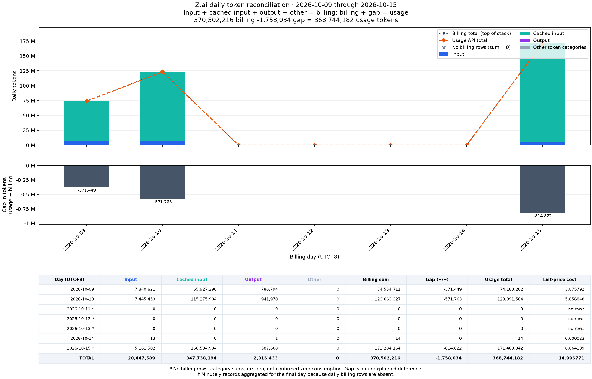

# zai_usage_resets

Show your [z.ai](https://z.ai) GLM coding-plan quota usage **and when each limit resets**.

The z.ai dashboard shows how much of your quota you've used, but not when it comes
back. This script reads the same monitoring endpoint the dashboard uses and prints
the `nextResetTime` values it already returns, converted to your local timezone.

```
Z.ai GLM coding plan — usage (plan: lite)

5-hour usage   [################....]  80%   resets 2026-07-30 14:13:55 CEST  (in 2h 05m)
Weekly usage   [###############.....]  76%   resets 2026-08-05 16:11:13 CEST  (in 6d 04h 02m)
Tool calls     [....................]   2%   resets 2026-08-01 16:11:13 CEST  (in 2d 04h 02m)
               2 of 100 used, 98 remaining
                 search-prime   2
                 web-reader     0
                 zread          0
```

## Setup

Requires `bash`, `curl` and `jq`.

```sh
cp .env.example .env       # then add your z.ai API key
./zai_usage_resets.sh
```

The key is read from `ZAI_API_KEY`, either from the environment or from a `.env`
file next to the script. `.env` is gitignored.

## Usage

```
./zai_usage_resets.sh            # usage report
./zai_usage_resets.sh --json     # raw API response
./zai_usage_resets.sh --probe    # also send a 1-token chat request (costs a prompt)
./zai_usage_resets.sh --help
```

Exit codes: `0` fine, `1` some limit is at 100%, `2` error — so it works in cron
or a monitor.

## Daily usage and billing

`zai_daily.py` compares daily billing records with Z.ai's usage report. Run it
with Docker Compose; Python and plotting dependencies stay in the container.
Set `ZAI_API_KEY` in `.env` as above, then:

```sh
docker compose run --build --rm daily --start-date 2026-10-09 --end-date 2026-10-15
# or
docker compose run --build --rm daily
```

Omit dates for month-to-date. Dates are inclusive, use **UTC+8**, and can span
up to 31 days. The full requested range is included. If the final day has no
daily billing rows, minutely records are aggregated automatically and marked `†`.

- **CLI:** daily totals and gaps, plus input/cached-input/output token counts
  and list-price costs, overall and per model.
- **Chart:** stacked billing categories, usage totals, signed gaps, and a daily
  table with list-price costs.
- **CSV:** exact daily counts, costs, and billing sources.

Files are saved to `reports/zai-daily.png` and `reports/zai-daily.csv` on the host.
Use `--output reports/custom.png` to change the name (`.svg` and `.pdf` also work),
or `docker compose run --rm daily --help` for options.

Gap means **usage − billing**; a negative value means billing reports more
tokens. The APIs can lag or disagree. `no rows` means missing billing data,
not confirmed zero usage or cost. List-price cost uses the ledger's model prices
in the account currency; it is not the amount charged for your Coding Plan.



[Example CSV](docs/zai-daily.csv)

## Caveat

`/api/monitor/usage/quota/limit` is undocumented, so z.ai may change or remove it
at any time. Unrecognised limit types are printed with their raw fields rather
than guessed at, and a malformed response exits `2` instead of reporting
something wrong.
